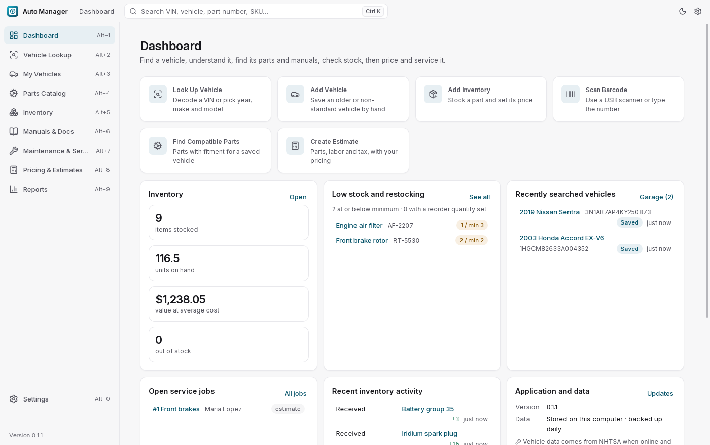
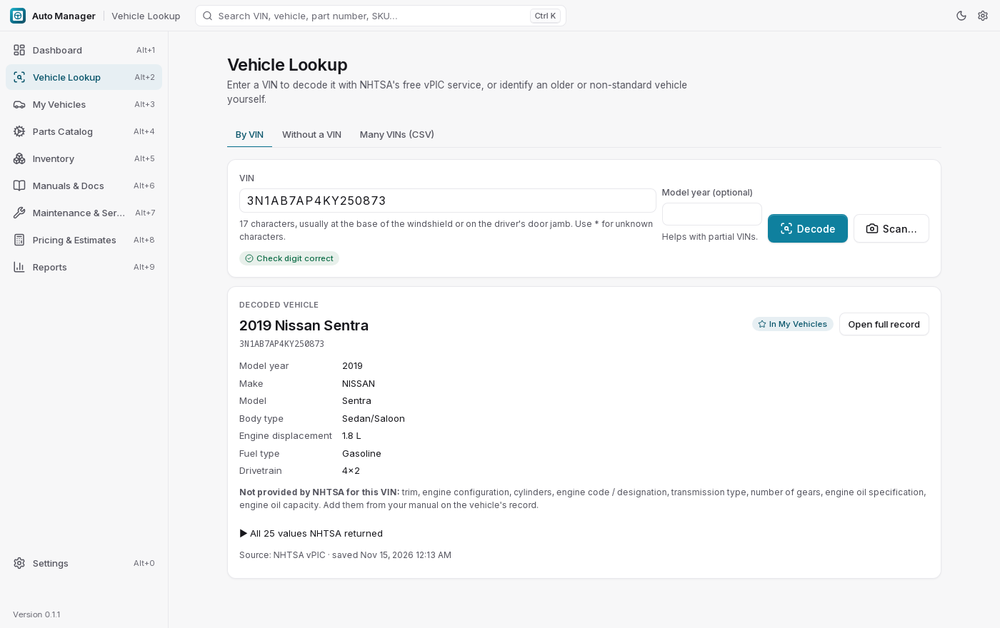
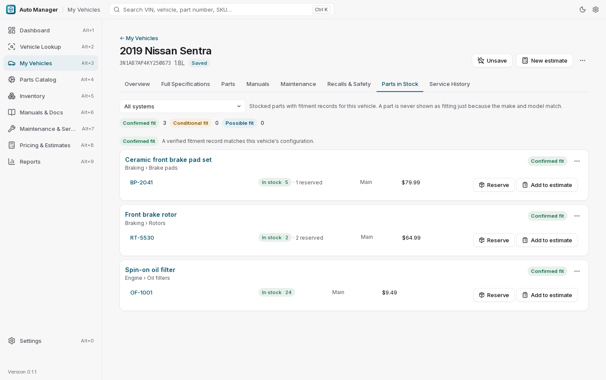
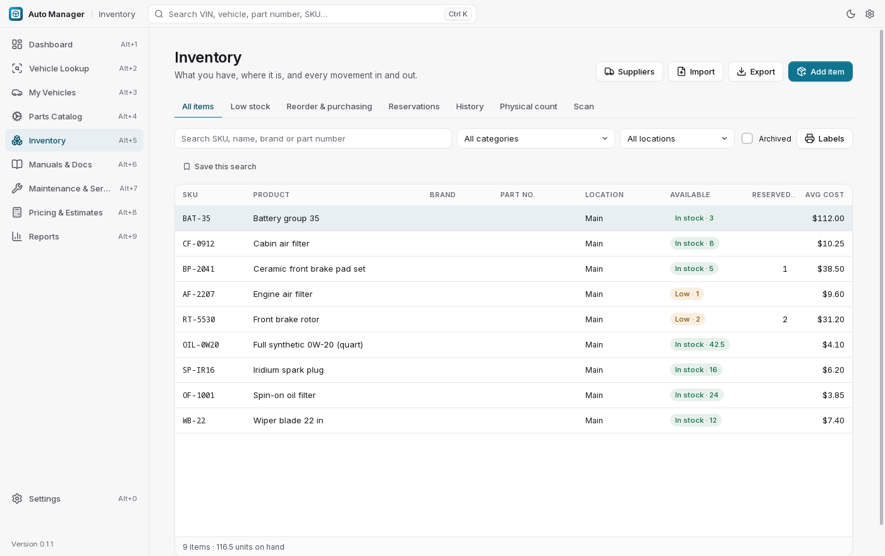
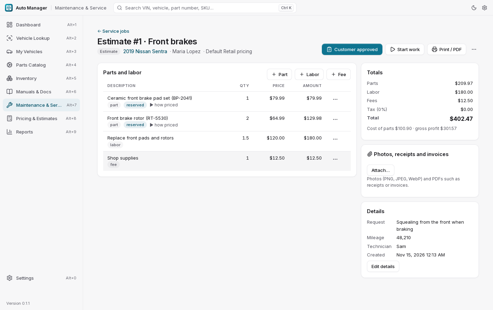
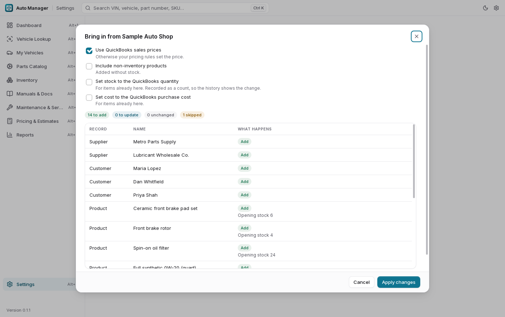
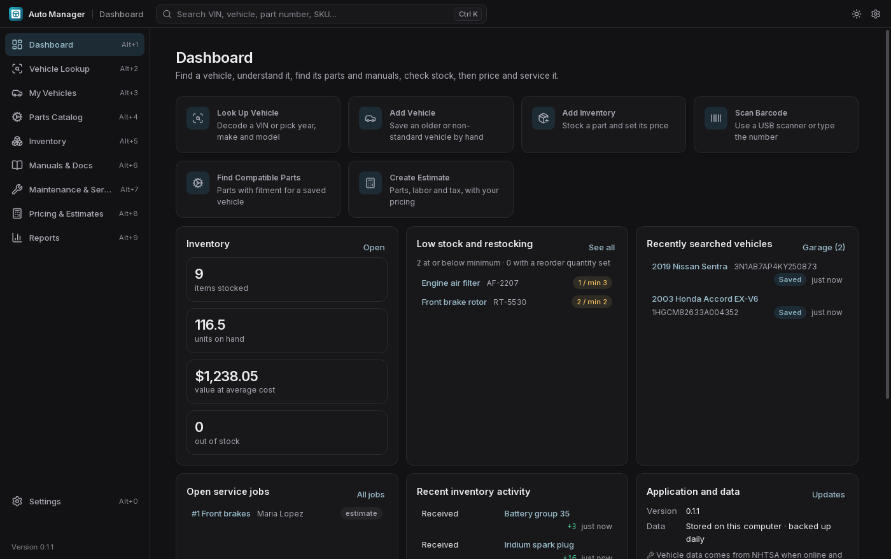

# Auto Manager

Find a vehicle → understand its specifications → find its parts and manuals → check inventory → manage pricing and service.

Auto Manager is a free, open-source (MIT) desktop app for Windows, macOS and Linux. Decode a VIN with NHTSA's free vPIC service and see every specification it returns, with where each value came from and what isn't known. Then:

- match the vehicle against your parts' fitment records;
- see what's in stock for it, and reserve it or add it to an estimate;
- open the manuals you've imported, and find components in them ("Where Is It?");
- run estimates, service jobs and invoices with pricing rules that explain themselves.

It's local-first: no account, no telemetry, and your data stays on your computer. Online lookups are saved, so anything you've looked up keeps working offline.

It's part of the Simple Suite family (Simple Cell, Simple Docs, Simple Viz, Simple Setup) and shares their design.

## What it does

| Area | Highlights |
|---|---|
| Vehicle Lookup | 17-character VIN with check-digit validation, partial VINs (`*`), **scanning the VIN with the camera or from a photo** (door-jamb barcodes and printed plates), CSV/Excel bulk decode (50 per request), identification without a VIN for older or non-US vehicles |
| Specifications | Every vPIC value, grouped, with its source and confidence. "Not available from free sources" where nothing is known. Your corrections are kept beside the original values. Dimensions (vPIC Canadian specifications) and engine and fuel economy (EPA), marked model-level |
| Parts & fitment | Hierarchical catalog with OEM, aftermarket, barcode and interchange numbers. Fitment records with conditions. Fit statuses: **Confirmed**, **Conditional**, **Possible**, **Not compatible**, **Unknown**. Never a fit from make and model alone. Supersession, interchange, and ACES/PIES and spreadsheet import |
| Inventory | Whole or fractional quantities with units (oil by the litre). Movement ledger (receive, issue, transfer, adjust, count, damage, returns) with database-enforced no-negative stock. Reservations that are never deducted twice. Undo. Multiple locations and bins. Weighted-average or last cost. CSV/Excel import with column mapping and duplicate detection. Labels (Code 128 or QR) |
| Pricing | Profiles with fixed, markup or margin rules by category, brand, item and quantity, plus minimum prices, rounding and tax. Every price shows how it was calculated. Decimal arithmetic throughout |
| Service | Estimates → approved → in progress → completed (stock consumed) → invoiced. Customers, labor, fees, discounts, printable estimates and invoices (Save as PDF) |
| Maintenance | Service intervals and specifications (torque, capacities, tire pressures…) found in your own manuals with the page cited, service history, what's due across the garage |
| Manuals | PDF library with a built-in viewer: zoom, search, contents, bookmarks, notes, print. Linked to vehicles, full-text searchable, with "Where Is It?" for components. Verified links to official owner-manual sites |
| Safety | NHTSA recall campaigns by model (clearly marked as *potentially* applicable), a per-VIN result you record, the model's technical service bulletins with their PDFs, and NHTSA 5-Star ratings |
| Diagnostics | Generic OBD-II code reference (OBDex, CC0). Read-only ELM327 scanner: codes, freeze frame, live data, VIN. Never clears codes |
| Purchasing | Suppliers, supplier part numbers and prices, price comparison, a reorder assistant, purchase orders, receiving, backorders, cost history |
| Reports | Inventory value, stock status, movement, usage, slow movers, turnover, revenue and margins, estimate conversion, supplier spending, vehicle history and cost. Print to PDF, CSV or Excel. Data Quality Center |
| Attachments | Photos and PDFs (receipts, invoices, diagrams) on vehicles, parts, inventory items and jobs |
| QuickBooks | Bring in products and services, prices, stock, customers and vendors from a QuickBooks Online or Desktop export, or by connecting to QuickBooks Online. Previewed row by row; importing again updates the same records. QuickBooks is never changed |
| Data | Automatic daily backups, verified restore, **two-way encrypted sync between computers through a shared folder**, full JSON export |
| Languages | English, Spanish and French |
| Updates | Signed updates from GitHub Releases, the same way as the other Simple Suite apps: a notice when a new version is out, then **Install and restart** (your data is backed up first). Nothing installs until you choose to |

The full list of what's done and what isn't, and how each part was verified, is in **[docs/LIMITATIONS.md](docs/LIMITATIONS.md)**.

## Install

Download the file for your computer from the **[latest release](https://github.com/fleetwoodjohnr/auto-manager/releases/latest)** (under *Assets*). The file names start with the system and processor they're for:

| Your computer | Download | |
|---|---|---|
| Windows 10 or 11 | `windows-x86_64-…_x64-setup.exe` (most PCs) or `windows-aarch64-…_arm64-setup.exe` (ARM, e.g. Snapdragon) | Installs for your user only; no administrator needed |
| Mac with Apple silicon (M1 or later) | `darwin-aarch64-…_aarch64.dmg` | macOS 11 or later |
| Mac with an Intel processor | `darwin-x86_64-…_x64.dmg` | macOS 11 or later |
| Ubuntu, Debian, Linux Mint | `linux-x86_64-…_amd64.deb` (or `…_arm64.deb`) | |
| Fedora, RHEL, openSUSE | `linux-x86_64-…x86_64.rpm` (or `…aarch64.rpm`) | |
| Any other Linux | `linux-x86_64-…_amd64.AppImage` (or `…_aarch64.AppImage`) | Runs without installing |

Not sure which Mac you have? Choose **Apple menu → About This Mac**: "Chip: Apple M…" means Apple silicon, "Processor: Intel" means Intel.

### Windows

1. Run the downloaded `…-setup.exe`.
2. If Windows shows **"Windows protected your PC"**, choose **More info → Run anyway**. It appears because the app isn't signed with a paid Microsoft certificate; updates are still checked against Auto Manager's own signature.
3. Follow the installer. Auto Manager is then in the Start menu.

### macOS

1. Open the downloaded `.dmg` and drag **Auto Manager** into **Applications**.
2. Open it from Applications. The first time, macOS says it can't check the app for malicious software, because it isn't notarized by Apple. Choose **Done**, then go to **System Settings → Privacy & Security**, scroll down and choose **Open Anyway** next to Auto Manager. You only do this once.

### Linux

- **.deb** (Ubuntu, Debian, Mint): `sudo apt install ./linux-x86_64-Auto.Manager_*_amd64.deb`
- **.rpm** (Fedora, RHEL, openSUSE): `sudo dnf install ./linux-x86_64-Auto.Manager-*.x86_64.rpm` (or `sudo zypper install …`)
- **AppImage** (any distribution): make it executable and run it: `chmod +x linux-x86_64-Auto.Manager_*_amd64.AppImage && ./linux-x86_64-Auto.Manager_*_amd64.AppImage`

Auto Manager then appears in your applications menu (the AppImage runs from wherever you keep the file).

### Check the download (optional)

Each release has a `SHA256SUMS` file. Put it in the same folder as your download, then run:

- Linux: `sha256sum -c --ignore-missing SHA256SUMS`
- macOS: `shasum -a 256 darwin-*.dmg`, and compare the result with the line for that file in `SHA256SUMS`.
- Windows (PowerShell): `Get-FileHash .\windows-x86_64-*.exe`, and compare the result with the line for that file in `SHA256SUMS`.

### Updates

Auto Manager checks for a new version when it starts and once a day (you can turn this off in **Settings → Updates**). When one is out, a notice appears in the corner: **Review update → Install and restart**. Your data is backed up first, and an update is installed only if its signature matches Auto Manager's release key. The .deb and .rpm updates ask for your password, because they install system-wide.

## Screenshots

| | |
|---|---|
|  **Vehicle Lookup.** A VIN decoded with NHTSA's free service. What NHTSA doesn't provide is named, never guessed. |  **Parts in Stock.** Parts that fit this vehicle by verified fitment records, with stock, reservations and price. |
|  **Inventory.** Stock by location, low-stock warnings, reservations and average cost. |  **Estimates and jobs.** Parts reserved from stock, labor and fees, with totals and profit. |
|  **QuickBooks.** Everything is reviewed before it's saved. |  **Dark theme**, or follow your system. |

The screenshots show a sample shop: the people, the company and the stock are made up. The vehicles were decoded from NHTSA's public data. They're regenerated with `node e2e/readme-shots.mjs`.

## Connect to QuickBooks

Auto Manager can bring in the business data you already keep in QuickBooks: **products and services** (as stock items with their sales price, purchase cost, quantity on hand, reorder point and preferred vendor), **customers** and **vendors** (as suppliers). Auto Manager only reads from QuickBooks; it never changes anything there.

There are two ways, both in **Settings → QuickBooks**.

### Import a QuickBooks export (QuickBooks Online and Desktop)

1. Export your lists from QuickBooks to Excel:
   - **QuickBooks Online**: **⚙ Settings → Products and services → More → Run report → Export to Excel**. For customers and vendors, open the **Customers** or **Vendors** list and choose **Export to Excel**.
   - **QuickBooks Desktop**: **Lists → Item List → Excel → Export all items**. For customers and vendors, open the **Customer Center** or **Vendor Center** and choose **Excel → Export Customer List** or **Export Vendor List**.
2. In Auto Manager, open **Settings → QuickBooks → Choose export…** and pick the file. Auto Manager recognizes which list it is.
3. Review what will happen to each record (**Add**, **Update**, **No change** or **Skip**, with the reason), then choose **Apply changes**.
4. Import products first, then customers and vendors, or in any order: each file is its own import.

### Connect to QuickBooks Online

1. Open **Settings → QuickBooks → Connect to QuickBooks**.
2. Your browser opens Intuit's sign-in page. Sign in, choose the company, and select **Connect**.
3. The browser comes back to a page that hands the answer to Auto Manager on your computer, and Auto Manager shows **Connected to *your company***.
4. The review opens straight away: check it and choose **Apply changes**.
5. Later, whenever QuickBooks has changed, choose **Bring in from QuickBooks…**. **Disconnect** signs Auto Manager out of QuickBooks; what was imported stays.

If the browser can't hand the answer back (some browsers block it), the page shows its address: copy it into the box in Auto Manager's **Connect to QuickBooks** window.

**Availability:** connecting straight to QuickBooks Online works once Intuit approves Auto Manager for live companies. Until a release includes that approval, the screen says the connection isn't available yet; the export import above brings in the same data.

### What to expect

- **Importing again updates instead of copying.** Auto Manager remembers which QuickBooks record each item, customer and supplier came from, even across computers that sync.
- **Prices:** QuickBooks' sales prices are used unless you untick **Use QuickBooks sales prices** (then your pricing rules decide).
- **Stock and cost** of items already in Auto Manager are left alone unless you tick **Set stock to the QuickBooks quantity** or **Set cost to the QuickBooks purchase cost**, because Auto Manager may have used stock since. A stock change is recorded as a count, so the history shows it.
- **Not brought in:** service items (labor is priced by your labor rate), bundles, price levels, tax rates, accounts and transactions. Non-inventory products only if you tick **Include non-inventory products**.
- Everything in one review is saved together, or not at all.

## Where your data lives

Everything is in one folder:

- Linux: `~/.local/share/dev.automanager.desktop`
- macOS: `~/Library/Application Support/dev.automanager.desktop`
- Windows: `%APPDATA%\dev.automanager.desktop`

The folder holds `auto-manager.db` (SQLite), `documents/` (imported PDFs), `attachments/`, `backups/` and `logs/`. **Settings → Data and backups** shows the exact path. Set `AUTO_MANAGER_DATA_DIR` to use another folder (for a portable install, or for testing).

## Documentation

- [User guide](docs/USER_GUIDE.md): the everyday workflows
- [Data providers](docs/PROVIDERS.md): what each source supplies, its terms, and how to add one
- [Architecture](docs/ARCHITECTURE.md) and [database](docs/DATABASE.md)
- [Development](docs/DEVELOPMENT.md): build, test, the end-to-end suite
- [Releasing](docs/RELEASING.md): signing keys, GitHub secrets, installer tests, and update behaviour per package type
- [Security](SECURITY.md)
- [Feature completion and limitations](docs/LIMITATIONS.md), and the [test report](docs/TEST_REPORT.md)

## License

MIT. See [LICENSE](LICENSE). Vehicle data from NHTSA and the EPA is U.S. Government work. Trouble-code descriptions come from [OBDex](https://github.com/foerbsnavi/OBDex) (data CC0 1.0).
